<picture>
  <source media="(prefers-color-scheme: dark)" srcset="https://raw.githubusercontent.com/Ashok-19/Ashok-19/output/header-dark.svg">
  
</picture>

<picture>
  <source media="(prefers-color-scheme: dark)" srcset="https://raw.githubusercontent.com/Ashok-19/Ashok-19/output/title-about-dark.svg">
  
</picture>

I work on **computer vision**, **deep learning**, **AI agents** and **reinforcement learning**, and I compete in [Kaggle](https://www.kaggle.com/ashok205) competitions. Currently learning **web development**.

<picture>
  <source media="(prefers-color-scheme: dark)" srcset="https://raw.githubusercontent.com/Ashok-19/Ashok-19/output/title-stack-dark.svg">
  
</picture>

<picture>
  <source media="(prefers-color-scheme: dark)" srcset="https://raw.githubusercontent.com/Ashok-19/Ashok-19/output/stack-dark.svg">
  
</picture>

<picture>
  <source media="(prefers-color-scheme: dark)" srcset="https://raw.githubusercontent.com/Ashok-19/Ashok-19/output/title-stats-dark.svg">
  
</picture>

<picture>
  <source media="(prefers-color-scheme: dark)" srcset="https://raw.githubusercontent.com/Ashok-19/Ashok-19/output/stats-dark.svg">
  
</picture>

<picture>
  <source media="(prefers-color-scheme: dark)" srcset="https://raw.githubusercontent.com/Ashok-19/Ashok-19/output/title-contrib-dark.svg">
  
</picture>

<picture>
  <source media="(prefers-color-scheme: dark)" srcset="https://raw.githubusercontent.com/Ashok-19/Ashok-19/output/contrib-dark.svg">
  
</picture>

<picture>
  <source media="(prefers-color-scheme: dark)" srcset="https://raw.githubusercontent.com/Ashok-19/Ashok-19/output/title-connect-dark.svg">
  
</picture>

<a href="https://linkedin.com/in/ashok-19"><picture>  <source media="(prefers-color-scheme: dark)" srcset="https://raw.githubusercontent.com/Ashok-19/Ashok-19/output/social-linkedin-dark.svg">  </picture></a>
<a href="https://www.kaggle.com/ashok205"><picture>  <source media="(prefers-color-scheme: dark)" srcset="https://raw.githubusercontent.com/Ashok-19/Ashok-19/output/social-kaggle-dark.svg">  </picture></a>
<a href="mailto:ashokraja1910@gmail.com"><picture>  <source media="(prefers-color-scheme: dark)" srcset="https://raw.githubusercontent.com/Ashok-19/Ashok-19/output/social-email-dark.svg">  </picture></a>

<picture>
  <source media="(prefers-color-scheme: dark)" srcset="https://raw.githubusercontent.com/Ashok-19/Ashok-19/output/footer-dark.svg">
  
</picture>

